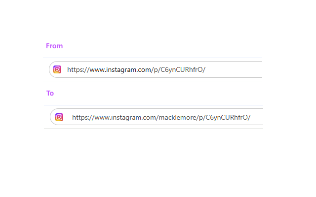

# Instagram Better URLs

Browser extension for Chrome, Firefox, and others to rewrite URLs for Instagram posts and reels to a less opaque format, automatically including the user's Instagram account name in the link.

## Screenshot

## Extension URLs

Most users will want to install it from one of the online extension/add-on stores:

* [Install for Chrome](https://chromewebstore.google.com/detail/instagram-better-urls/ogfenmnaeimmgjcfbncdaofcbbpenjfo)
* [Install for Firefox](https://addons.mozilla.org/en-US/firefox/addon/instagram-better-urls/)
